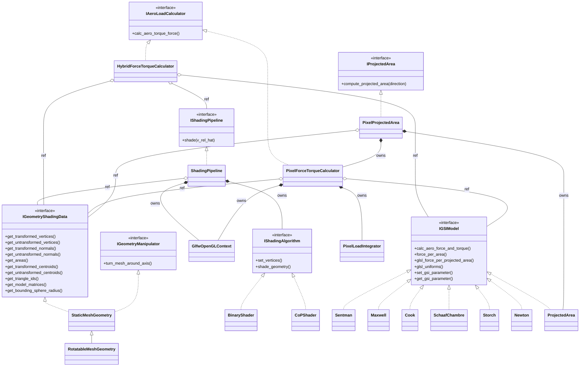

# Architecture

VAT is built from a handful of interfaces. Every concrete class is interchangeable with any other
implementation of the same interface, and nothing downstream knows which one it received. That
is what makes it cheap to add a GSI model, swap a shading algorithm or a load calculator, or drop
in a different geometry source without touching the rest of the pipeline.

## Class diagram

Solid diamonds are ownership (`unique_ptr`); open diamonds are non-owning references. Every
object the calculators and the pipeline use must therefore outlive them — the caller owns the
geometry, the pipeline and the GSI model, and passes them in by reference. (The MATLAB class
`vat.loads.PixelForceTorqueCalculator` holds on to its geometry and GSI model for that reason.)

## The interfaces

**`IGeometryShadingData`** ([core/Igeometry_shading_data.h](../src/core/Igeometry_shading_data.h))
supplies geometry: vertices, per-triangle normals, areas, centroids, triangle IDs, per-mesh
model matrices, and the bounding sphere radius. Vertices and normals come in two flavours, see
*Untransformed versus transformed* below. It is the only thing the rest of the pipeline
knows about geometry.

**`IGeometryManipulator`** ([core/Igeometry_manipulator.h](../src/core/Igeometry_manipulator.h))
is deliberately separate. Articulating a part — deflecting a solar array, feathering a panel —
writes a per-mesh model matrix; it never touches vertex data.

**`IShadingPipeline`** ([loads/Ishading_pipeline.h](../src/loads/Ishading_pipeline.h))
answers one question: given a flow direction, which fraction of each triangle is exposed?
`ShadingPipeline` implements it by owning a hidden GLFW window for the OpenGL context and
delegating the actual rendering to an `IShadingAlgorithm`.

**`IGSIModel`** ([loads/Igsi_model.h](../src/loads/Igsi_model.h))
computes force and torque for a *single* triangle from its area, normal, centroid, the
flow vector, the surface temperature and the atmospheric conditions. It knows nothing about
occlusion — that is the pipeline's job. Every model carries the same formula twice:
`force_per_area()` in C++ (force per unit wetted area, including shear;
`calc_aero_force_and_torque()` is that times the area) and `glsl_force_per_projected_area()`
in GLSL for the GPU, with `glsl_uniforms()` supplying the values its uniforms need. The two
are tested against each other on random inputs
([test_glsl_matches_cpp.cpp](../test/gsi_models/test_glsl_matches_cpp.cpp)).

**`IAeroLoadCalculator`** ([core/Iaero_load_calculator.h](../src/core/Iaero_load_calculator.h))
is the composition point that turns per-element physics into a total load. There are two:
`HybridForceTorqueCalculator` works per triangle, `PixelForceTorqueCalculator` per pixel.

**`IProjectedArea`** ([core/Iprojected_area.h](../src/core/Iprojected_area.h))
gives the area the geometry shows along a direction, with shadowing. `PixelProjectedArea`
([projected_area/pixel_projected_area.h](../src/projected_area/pixel_projected_area.h))
implements it with no physics of its own: it owns a `PixelForceTorqueCalculator` running the
`ProjectedArea` GSI model, whose force per projected area is `(1, 0, 0)`, so the x component of
the total force is the projected area, coverage-weighted with MSAA. The direction follows the
`v_rel` convention: surfaces with `dot(n, direction) > 0` count. The calculator runs in
`FlowRegime::Hyperthermal`, because leeward surfaces add nothing. `ProjectedArea` lives in this
module, not in `gsi_models/`, because it measures geometry rather than modelling a gas.

## How one evaluation flows (Hybrid)

`HybridForceTorqueCalculator::calc_aero_torque_force` is the whole story in one loop
([hybrid_aero_load_calculator.cpp](../src/loads/hybrid_aero_load_calculator.cpp)):

1. Shade once for the given flow direction, producing one visibility factor per triangle.
2. For each triangle, ask the GSI model for its force and torque contribution.
3. Multiply that contribution by the triangle's visibility factor and accumulate.

Back-facing triangles — those with `dot(normal, v_rel) <= 0` — bypass the shading result and are
assigned visibility 1.0. This is safe because the GSI model is itself responsible for returning
approximately zero force on a leeward element, and it avoids paying for a visibility lookup on
triangles that cannot be loaded anyway.

Every `IAeroLoadCalculator` carries a `FlowRegime` (`set_flow_regime` / `get_flow_regime`; for
construction, both calculators take a trailing `FlowRegime` constructor argument). The default,
`Hypothermal`, behaves as described. With `Hyperthermal`, back-facing triangles are skipped
entirely and only windward surfaces contribute; the Pixel calculator then skips its leeward CPU
loop. In MATLAB: `Hyperthermal=true` at construction, or the `Hyperthermal` property.

## How one evaluation flows (Pixel)

`PixelForceTorqueCalculator` ([pixel_force_torque_calculator.cpp](../src/loads/pixel_force_torque_calculator.cpp))
does not ask which triangles are visible, it integrates the load over the visible *surface*.
It owns its own hidden OpenGL context and needs no shading pipeline.

1. **G-buffer pass.** The same orthographic camera along the flow as the shading algorithms
   (`gl::make_flow_camera`) renders the front-most surface. Its fragment shader, assembled from
   the model's GLSL, evaluates the GSI model once per pixel and triangle, with the triangle's
   exact normal, wherever the surface faces the flow (`cos(delta) = dot(n, v_hat) > 0`). It
   writes the force per *projected* area `f(n, v, T_w)` (`force_per_area / cos(delta)`, with
   `w = 1`) and `r x f` (with the wetted-area weight `1 / max(cos(delta), min_cos_delta)`) into
   two RGBA32F targets, `r` the interpolated body-frame position. Leeward faces are culled, as in
   the shading algorithms, so the leeward face of a two-sided plate cannot hide the windward one
   it lies on. This assumes closed or two-sided geometry: a one-sided sheet facing away from the
   flow casts no shadow. With anti-aliasing, see **Anti-aliasing** below.
2. **Integration pass** ([pixel_load_integrator.cpp](../src/loads/pixel_load_integrator.cpp)).
   One compute shader only scales and sums the G-buffer: `dF = f * A_px` and `dT = (r x f) * A_px`
   per pixel, `A_px = (2R/N)^2`. Each 16x16 workgroup reduces a 32x32 tile in shared memory, in a
   fixed order, and writes one partial sum; the CPU adds those in double, also in a fixed order.
   No float atomics, so the result is bit-for-bit reproducible on a given GPU and driver.
3. **Leeward triangles**, `dot(n, v) <= 0`, are invisible to the camera. They are evaluated per
   triangle on the CPU with `calc_aero_force_and_torque()` and no shadowing, exactly as Hybrid
   does. Degenerate triangles (NaN normal) are skipped.

Partly shaded triangles therefore count with exactly their exposed part, and the result depends
on `num_pixel` only, not on the meshing: a plate as 2 or as 10,000 triangles gives the same
loads to 1e-5, and the error against analytic results falls like 1/N
([pixel_force_torque_accuracy_test.cpp](../test/loads/pixel_force_torque_accuracy_test.cpp)).

**Anti-aliasing.** The constructor argument `num_msaa_samples` (default 1) renders the G-buffer with that
many samples per pixel. The fragment shader still runs once per pixel and triangle, not once per
sample, and MSAA stores its result in every sample the triangle covers and wins the depth test
in. `r` is taken at the mean of the covered samples (`gl_SampleMaskIn`); `r` is affine across a
triangle and `r x f` linear in it, so that is the torque of shading every sample.
`glBlitFramebuffer` then resolves the G-buffer into a single-sample copy
(`gl::FrameBuffer::resolve_color_into`), which averages the samples of each pixel, uncovered ones
(cleared to 0) included, and the integration pass reads that copy unchanged:

- the coverage `c` (resolved `w`, 1 or 0 without anti-aliasing) means a pixel a silhouette or
  shadow edge cuts through counts with only its covered part;
- a pixel on a crease or a depth jump gets the sample-weighted mean of its faces' loads, exactly
  what evaluating every sample would give.

Averaging the normals first and evaluating the model once per pixel would not be exact there,
because the models are nonlinear in the normal: on a box with Newton and a faceted sphere with
Sentman that made MSAA less accurate than one sample. Now MSAA beats one sample on both
(`MsaaBeatsOneSampleAtCreasesForNewtonAndSentman`). GL leaves it to the driver how a blit combines
the samples; `MsaaReducesTheEdgeErrorOfTheShadowedPlates` fails on a driver that does not
average them.

Cost: the G-buffer takes `k * 16 B * N^2 * (samples + 1)`, `k` = 2 targets, 3 with
`keep_pressure_image` (the sample count is reduced if that does not fit). On the development
GPU, 8 samples cost 1.1-3x the time of one sample at the same N, growing with N, mostly the
multisampled G-buffer writes and the resolve. That pays off: on the box and sphere above, 8
samples at N = 1024 are 2-22x more accurate than one sample at N = 2000 and slightly faster
(`DISABLED_MsaaBenchmark` in [pixel_msaa_benchmark.cpp](../test/loads/pixel_msaa_benchmark.cpp)).

**Grazing incidence.** Working per projected area turns `A_px / cos(delta)` into a finite factor
for the hyperthermal models: Newton, Cook and Storch divide the `cos(delta)` out analytically.
The thermal models (Sentman, Schaaf–Chambre, Maxwell) keep a non-zero load at `cos(delta) -> 0`,
so they divide by `max(cos(delta), min_cos_delta)` (constructor argument, default 1e-3). A surface
seen almost edge-on covers few pixels with large weight each, which is where the thermal models
are least accurate.

**Diagnostics.** `last_wetted_area()` and `last_projected_area()` report the areas the last
evaluation integrated over; with `keep_pressure_image` set, `pressure_image()` returns the
per-pixel pressure.

**Choosing a calculator.** `perf_probe <mesh> --pixel` compares both on any mesh. Hybrid's
visibility is all-or-nothing per triangle, so on meshes with large, partly shaded triangles its
result converges to a mesh-dependent value. On `shuttlecock_15k.obj` with Sentman, Hybrid at
N = 4000 stays up to 2.6% (Binary) and 1.9% (CoP) in force away from the converged pixel result
over the probe's four flow directions, while the pixel result at N = 4000 is within 0.04%.
Hybrid remains the reference for convex bodies, where both agree to O(1/N).

## The two shading algorithms

Both render under an orthographic projection along the flow direction, and both currently return
0.0 or 1.0 per triangle, though the interface permits fractional values.

- **`BinaryShader`** renders triangle IDs. A triangle counts as visible if any pixel carries
  its ID.
- **`CoPShader`** renders triangle depth, then re-renders each triangle's *centre of pressure*
  (its centroid) as a single point, moved 0.005 along its normal. The triangle is visible if
  that point survives the depth test. This carries less area-quantization bias than the binary
  approach at the same resolution. It uses `BinaryShader`'s render structure (a depth-only pass,
  then `GL_LEQUAL` points with depth writes off, each marking its triangle in the visibility
  buffer), so there is no ID image and no reduction pass. The offset puts the point in front of
  its own triangle despite the small depth mismatch between a point and a triangle fragment.

`num_pixel` is the square render resolution, and the single accuracy/runtime knob. Leave it
out and `ShadingPipeline` chooses it from the mesh's narrowest triangles
([pixel_sizing.h](../src/shading/pixel_sizing.h) has the rule and the measurements behind it).

## Geometry data layout

Two details are easy to get wrong and worth stating explicitly.

**Vertices are de-indexed.** `StaticMeshGeometry` loads through assimp with
`aiProcess_Triangulate | aiProcess_JoinIdenticalVertices`, then expands the result so that
`m_vertices` holds nine floats per triangle — three explicit vertices. Consequently
`get_triangle_ids()` is **not** an index buffer. It is a per-vertex `uint32` attribute carrying
the same value three times, used as a render-target colour. IDs are **1-based**, so a `0` in the
ID framebuffer means background.

**Untransformed versus transformed vertices.** `RotatableMeshGeometry` overrides the getters to apply the
per-mesh model matrices, so `get_transformed_vertices()`, `get_transformed_normals()` and `get_transformed_centroids()` return already-transformed
geometry. The GPU paths instead upload `get_untransformed_vertices()` and `get_untransformed_normals()`, because they
apply the model matrices themselves — uploading the transformed data would apply the rotation
twice. Positions are transformed with `w = 1`; normals go through the inverse transpose of the
linear block only, on the CPU and on the GPU alike, so they never pick up the model matrix's
translation column.

## Target layout

One CMake target per `src/` subdirectory, each with a `Vat::` alias and its own
`target_include_directories`. Headers are therefore included flat — `#include "sentman.h"` —
never by relative path. `core` is header-only (INTERFACE). The subdirectories under
`shading/` (`binary_shader/`, `cop_shader/`) and the `shaders/` folders of `loads/`,
`gsi_models/` and `projected_area/` define no targets of their own; they belong to the parent
target.

`loads` links `gl` PRIVATE: no public `loads` header exposes an OpenGL type (the pixel
calculator keeps its GL state behind a pimpl), so the GSI models, which link `loads` for
`IGSIModel`, do not compile against the GL wrappers.

## Namespaces

Everything lives under `vat`. The cross-module vocabulary sits at the root, and each
module gets a nested namespace named after its folder and CMake target:

| namespace | holds |
|---|---|
| `vat` | `AeroConditions` and the six interfaces every module speaks: `IGSIModel`, `IShadingPipeline`, `IAeroLoadCalculator`, `IProjectedArea`, `IGeometryShadingData`, `IGeometryManipulator` |
| `vat::gsi_models` | `Sentman`, `Cook`, `Maxwell`, `Newton`, `SchaafChambre`, `Storch` |
| `vat::geometry` | `StaticMeshGeometry`, `RotatableMeshGeometry`, `MeshData`, `compute_mesh_quality`, `write_obj` |
| `vat::shading` | `ShadingPipeline`, `ShadingAlgorithmType`, `IShadingAlgorithm`, `BinaryShader`, `CoPShader`, `VisibilityReducer`, `suggest_num_pixel` |
| `vat::loads` | `HybridForceTorqueCalculator`, `PixelForceTorqueCalculator`, `PixelLoadIntegrator` |
| `vat::projected_area` | `PixelProjectedArea` and the `ProjectedArea` GSI model it runs |
| `vat::remeshing` | `remesh`, `predict_remesh`, `RemeshOptions`, `RemeshReport`; CGAL stays inside the module |
| `vat::visualization` | `show_shading`, `show_meshes`, `show_hinges` |
| `vat::gl` | the OpenGL wrappers — `Shader`, `ComputeShader`, `VertexArray`, `VertexBuffer`, `FrameBuffer`, … — plus `make_flow_camera`, the orthographic camera along the flow every GPU path uses, and `ScopedCurrentContext`, which makes a context current and restores the previous one |

One deliberate exception to "namespace == folder":

- The root-namespace contracts are spread across `core/` and `loads/` rather than living in
  one folder, because a header's folder decides which CMake target owns it. `IGSIModel` and
  `IShadingPipeline` are compiled into `loads` but are named `vat::IGSIModel` and
  `vat::IShadingPipeline`, not `vat::loads::…`.

`gl` is a module in its own right, at `src/gl/`, not a part of shading. Its wrappers carry
generic names — `Shader`, `VertexBuffer` and `FrameBuffer` would collide with any other
renderer linked into the same program — which is what the namespace is for. Shading is
simply its first consumer; anything else that moves work onto the GPU links `gl` the same
way, without depending on shading.

`.cpp` files inside `vat::shading` open with a TU-local `using namespace gl;` so the OpenGL
call sites stay readable. That directive never appears in a header.

The embedded GLSL sources get one namespace per backend — `vat::shading::binary_glsl`,
`vat::shading::cop_glsl`, `vat::loads::pixel_glsl`, and one per GSI model
(`vat::gsi_models::sentman_glsl`, …, with the shared helpers such as `vat_erfc` in
`vat::gsi_models::common_glsl`, and `vat::projected_area::projected_area_glsl`). The two shading backends both declare `ID_vertex_shader` and `ID_fragment_shader`,
and before this they were two `inline` definitions of the same global name. Identical text
made that legal, but the moment one backend's GLSL was edited alone it would have become a
silent ODR violation, with the linker keeping one definition and one backend rendering with
the other's shader. Separate namespaces let the two diverge freely.

`MexFunction` in [mex_gateway.cpp](../bindings/matlab/mex_gateway.cpp) stays in the global namespace —
MATLAB resolves the entry point by that exact name — so that file pulls in the toolbox types
with individual `using` declarations instead of being wrapped.
